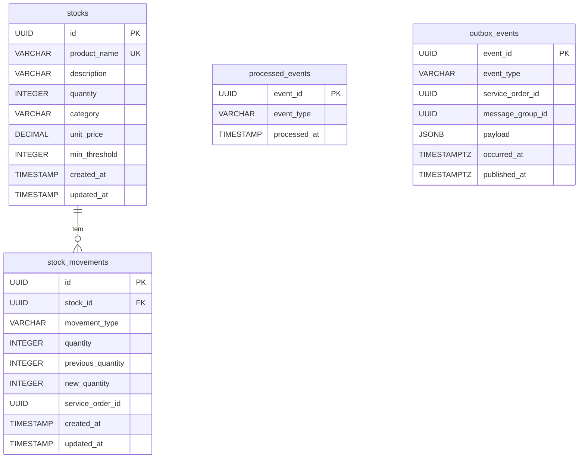

# Banco de Dados

O ms-ofisy-stock tem seu próprio banco **PostgreSQL 16** (`ms_ofisy_stock_db`), separado do banco do core. O schema é versionado com Flyway (ver [FLYWAY.md](FLYWAY.md)).

Localmente, o banco sobe pelo `compose.db.yaml` (ou `compose.yaml`) e fica exposto em `localhost:5434`, para não conflitar com o banco do core na porta 5432.

---

## Diagrama



Só `stock_movements` se relaciona com `stocks`. As tabelas de mensageria são independentes.

---

## Tabelas

### `stocks`

Um item de estoque e o seu saldo atual.

| Coluna          | Tipo             | Nulo | Descrição                                                        |
|-----------------|------------------|------|------------------------------------------------------------------|
| `id`            | `UUID`           | não  | Chave primária, `gen_random_uuid()` por padrão                   |
| `product_name`  | `VARCHAR(255)`   | não  | Nome do produto, único                                           |
| `description`   | `VARCHAR(255)`   | não  | Descrição do produto                                             |
| `quantity`      | `INTEGER`        | não  | Saldo atual. Começa em `0` por padrão                            |
| `category`      | `VARCHAR(255)`   | não  | Categoria do produto (`Freios`, `Motor`, ...)                    |
| `unit_price`    | `DECIMAL(10, 2)` | não  | Preço unitário                                                   |
| `min_threshold` | `INTEGER`        | não  | Saldo mínimo. Com o saldo igual ou abaixo dele, o item está baixo |
| `created_at`    | `TIMESTAMP`      | não  | Criação do registro                                              |
| `updated_at`    | `TIMESTAMP`      | não  | Última alteração                                                 |

**Constraints**

| Nome                     | Regra                   | Motivo                                                                    |
|--------------------------|-------------------------|---------------------------------------------------------------------------|
| `uq_stocks_product_name` | `UNIQUE (product_name)` | Um produto só é cadastrado uma vez. O cadastro duplicado responde `409`   |

**Índices**

| Nome                  | Coluna     | Consulta atendida        |
|-----------------------|------------|--------------------------|
| `idx_stocks_category` | `category` | Filtro por categoria     |

A busca por nome do produto usa o índice criado pela constraint `UNIQUE`.

### `stock_movements`

Histórico de cada entrada (`IN`) e saída (`OUT`) de um item, com o saldo antes e depois.

| Coluna              | Tipo          | Nulo | Descrição                                                              |
|---------------------|---------------|------|------------------------------------------------------------------------|
| `id`                | `UUID`        | não  | Chave primária, `gen_random_uuid()` por padrão                         |
| `stock_id`          | `UUID`        | não  | Item movimentado                                                       |
| `movement_type`     | `VARCHAR(50)` | não  | `IN` ou `OUT`                                                          |
| `quantity`          | `INTEGER`     | não  | Quantidade movimentada                                                 |
| `previous_quantity` | `INTEGER`     | não  | Saldo antes da movimentação                                            |
| `new_quantity`      | `INTEGER`     | não  | Saldo depois da movimentação                                           |
| `service_order_id`  | `UUID`        | sim  | OS que originou a movimentação. Vazio nas movimentações feitas pela API |
| `created_at`        | `TIMESTAMP`   | não  | Criação do registro                                                    |
| `updated_at`        | `TIMESTAMP`   | não  | Última alteração                                                       |

**Constraints**

| Nome                               | Regra                              | Motivo                                                      |
|------------------------------------|------------------------------------|-------------------------------------------------------------|
| `fk_stock_movements_stock`         | `stock_id → stocks.id`             | A movimentação sempre pertence a um item deste banco        |
| `ck_stock_movements_movement_type` | `movement_type IN ('IN', 'OUT')`   | Garante no banco os mesmos valores do enum `MovementType`   |

**Índices**

| Nome                                   | Coluna             | Consulta atendida                               |
|----------------------------------------|--------------------|-------------------------------------------------|
| `idx_stock_movements_stock_id`         | `stock_id`         | Movimentações de um item                        |
| `idx_stock_movements_created_at`       | `created_at`       | Ordenação por data                              |
| `idx_stock_movements_service_order_id` | `service_order_id` | O que saiu e o que voltou para uma OS           |

**Devolução por OS:** o `service_order_id` é o que permite devolver os itens de uma OS sem depender de outro serviço. A devolução soma, por item, o que saiu (`OUT`) menos o que já voltou (`IN`) para a OS e devolve só a diferença. Repetir a devolução não altera o saldo.

**Sem chave estrangeira para a OS:** o `service_order_id` referencia uma OS que pertence ao core, em outro banco. A consistência entre eles é garantida pela saga, não pelo banco.

### `processed_events`

Registro dos eventos já processados, usado para descartar reentregas.

| Coluna         | Tipo           | Nulo | Descrição                                   |
|----------------|----------------|------|---------------------------------------------|
| `event_id`     | `UUID`         | não  | Chave primária, o `eventId` do envelope     |
| `event_type`   | `VARCHAR(100)` | não  | Tipo do evento                              |
| `processed_at` | `TIMESTAMP`    | não  | Momento do processamento                    |

O registro deve ser gravado na mesma transação do efeito do evento. Se o processamento falhar, nenhum dos dois é persistido e o evento pode ser reprocessado.

### `outbox_events`

Eventos produzidos por este ms, aguardando ou já publicados no SNS ([MESSAGING.md](MESSAGING.md#publicação-de-eventos-outbox)).

| Coluna             | Tipo           | Nulo | Descrição                                                                   |
|--------------------|----------------|------|-----------------------------------------------------------------------------|
| `event_id`         | `UUID`         | não  | Chave primária, vira o `eventId` do envelope                                |
| `event_type`       | `VARCHAR(100)` | não  | Tipo do evento                                                              |
| `service_order_id` | `UUID`         | sim  | OS do evento. Vazio em eventos que não pertencem a uma OS, como o `StockLow` |
| `message_group_id` | `UUID`         | não  | Usado como `message-group-id`: a OS, ou o id do item nos eventos sem OS      |
| `payload`          | `JSONB`        | não  | Dados específicos do tipo de evento                                         |
| `occurred_at`      | `TIMESTAMPTZ`  | não  | Momento do evento, define a ordem de publicação                             |
| `published_at`     | `TIMESTAMPTZ`  | sim  | Preenchido quando o evento é publicado no SNS                               |

As datas usam `TIMESTAMPTZ` porque o `occurredAt` do envelope é um `Instant`.

**Índices**

| Nome                        | Coluna        | Consulta atendida                                                                                                  |
|-----------------------------|---------------|--------------------------------------------------------------------------------------------------------------------|
| `idx_outbox_events_pending` | `occurred_at` | Busca dos pendentes pelo publicador. Parcial (`WHERE published_at IS NULL`), então não cresce com os já publicados |

---

## Migrations

| Versão | Arquivo                                           | Conteúdo                                                                  |
|--------|---------------------------------------------------|---------------------------------------------------------------------------|
| V1     | `V1__create_stocks_table.sql`                     | Tabela `stocks` e índice de categoria                                     |
| V2     | `V2__create_stock_movements_table.sql`            | Tabela `stock_movements`, chave estrangeira, check do tipo e índices      |
| V3     | `V3__insert_stock_data.sql`                       | Massa de dados com 16 itens em 6 categorias                               |
| V4     | `V4__add_constraints_to_stock_tables.sql`         | `NOT NULL` em `description`, `category` e `updated_at`, e nome único      |
| V5     | `V5__add_service_order_id_to_stock_movements.sql` | Coluna `service_order_id` em `stock_movements` e índice                   |
| V6     | `V6__create_processed_events_table.sql`           | Tabela `processed_events`                                                 |
| V7     | `V7__create_outbox_events_table.sql`              | Tabela `outbox_events` e índice dos pendentes                             |

A massa de dados (V3) usa os mesmos IDs de itens da migration de seed do core (`V8__insert_stock_data.sql`), para facilitar testes ponta a ponta.

## Consultas úteis

```bash
make db-outbox
make db-processed-events
```
