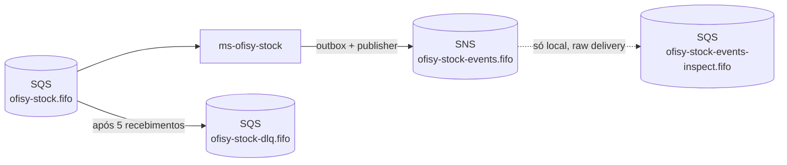
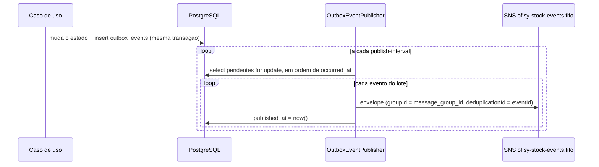

# Mensageria

O ms-ofisy-stock se comunica com os demais microsserviços por eventos, usando **Amazon SNS + SQS** ([ADR-0011](https://github.com/15SOAT-FIAP/techchallenge-ofisy/blob/master/docs/adr/0011-utilizar-sns-e-sqs-como-mensageria.md)), com a saga coordenada por coreografia ([ADR-0012](https://github.com/15SOAT-FIAP/techchallenge-ofisy/blob/master/docs/adr/0012-coordenar-a-saga-por-coreografia.md)). Os eventos publicados pelo estoque saem por um *transactional outbox* para o tópico `ofisy-stock-events.fifo`, e os eventos dos outros serviços chegam por uma única fila FIFO, `ofisy-stock.fifo`.

A estrutura é a mesma do core e do `ms-ofisy-execution`: mesmo envelope, mesmo outbox e mesmo despacho por `type`. Assim, um evento publicado por qualquer serviço tem o mesmo contrato.

---

## Topologia



| Recurso          | Nome                              | Observação                                                         |
|------------------|-----------------------------------|--------------------------------------------------------------------|
| Tópico           | `ofisy-stock-events.fifo`         | Tópico deste ms, configurado em `ofisy.messaging.topics.stock`     |
| Fila             | `ofisy-stock.fifo`                | Configurada em `ofisy.messaging.queues.stock` (`application.yaml`) |
| DLQ              | `ofisy-stock-dlq.fifo`            | `RedrivePolicy` com `maxReceiveCount=5`                            |
| Fila de inspeção | `ofisy-stock-events-inspect.fifo` | Só local. Assinada no tópico deste ms para ver o que foi publicado |

Ainda não há assinaturas da fila em tópicos de outros serviços: elas entram junto com o primeiro handler de cada evento.

Localmente, tudo é criado pelo `localstack/init/ready.d/01-messaging.sh`, que roda quando o LocalStack sobe (pelo `compose.yaml`, pelo `compose.db.yaml` e nos testes de integração). Com `queue-not-found-strategy: fail`, a aplicação não inicia se a fila não existir.

Na AWS, os recursos vêm do repositório de infraestrutura. O tópico é configurado pelo **nome**: o `SnsConfig` registra um `TopicsListingTopicArnResolver`, que descobre o ARN listando os tópicos (`sns:ListTopics`) em vez de chamar `CreateTopic`, e guarda o resultado em cache. A aplicação precisa de `sns:ListTopics`, `sns:Publish` e, na fila, `sqs:GetQueueUrl`, `sqs:ReceiveMessage`, `sqs:DeleteMessage` e `sqs:ChangeMessageVisibility`.

---

## Contrato dos eventos

Todo evento segue o mesmo envelope (`adapters/listeners/dto/EventEnvelope.java`). O `payload` varia conforme o `type`:

| Campo            | Tipo    | Descrição                                                                   |
|------------------|---------|-----------------------------------------------------------------------------|
| `eventId`        | UUID    | Identificador único do evento, usado para idempotência                      |
| `type`           | String  | Tipo do evento, usado no filtro da assinatura e no despacho                 |
| `serviceOrderId` | UUID    | Ordem de serviço à qual o evento se refere. Nulo em eventos sem OS          |
| `occurredAt`     | Instant | Momento em que o evento ocorreu no produtor                                 |
| `payload`        | JSON    | Dados específicos do tipo de evento                                         |

```json
{
  "eventId": "5e6f7a8b-9c0d-4e1f-8a2b-3c4d5e6f7a8b",
  "type": "StockConsumed",
  "serviceOrderId": "c3d4e5f6-a7b8-9012-cdef-123456780001",
  "occurredAt": "2026-10-20T10:00:00Z",
  "payload": { "quoteId": "9a2b3c4d-5e6f-7a8b-9c0d-1e2f3a4b5c6d" }
}
```

### Eventos consumidos

| Evento | Produtor | Efeito |
|--------|----------|--------|
| —      | —        | —      |

### Eventos publicados

| Evento | Quando é publicado | Quem reage |
|--------|--------------------|------------|
| —      | —                  | —          |

---

## Consumo de eventos

O `StockEventsListener` (`adapters/listeners/`) escuta a fila `ofisy-stock.fifo`. Ele não conhece os eventos: recebe todos os `EventHandler` registrados no Spring e despacha pelo `type`. Cada tipo de evento tem seu próprio handler em `adapters/listeners/handlers/`.

- **Tipo sem handler**: o evento é logado como ignorado e confirmado, sem passar pelo banco.
- **Mensagem inválida ou erro no processamento**: a exceção impede o ack, a mensagem volta para a fila depois do *visibility timeout* e, depois de 5 recebimentos, vai para a DLQ.
- **Ordenação**: as mensagens chegam com `message-group-id = serviceOrderId`, então eventos de uma mesma OS são processados em ordem e OSs diferentes em paralelo.
- **Idempotência**: a entrega do SQS é *at-least-once*. O caso de uso acionado pelo handler registra o `eventId` em **`processed_events`** (`domain/messaging/ProcessedEventRepository`) na mesma transação do seu efeito e descarta o evento se o `eventId` já existir.

### Como adicionar um novo evento consumido

1. Criar o DTO do payload em `adapters/listeners/dto/`.
2. Criar um `@Component` em `adapters/listeners/handlers/` implementando `EventHandler`, com `type()` retornando o nome do evento.
3. No caso de uso acionado pelo handler, checar e gravar o `eventId` em `processed_events` na mesma transação.
4. Criar a assinatura da fila no tópico do produtor, com `RawMessageDelivery=true` e `FilterPolicy` pelo `type` (`FilterPolicyScope=MessageBody`), em `localstack/init/ready.d/01-messaging.sh` e na infraestrutura da AWS.
5. Cobrir com teste unitário do handler e com um cenário no `StockEventsListenerIT`.
6. Adicionar a linha na tabela de [eventos consumidos](#eventos-consumidos).

---

## Publicação de eventos (outbox)

Os casos de uso não chamam o SNS: eles gravam o evento na tabela `outbox_events`, na mesma transação da mudança de estado, e o `OutboxEventPublisher` é quem publica no tópico, de forma agendada, seguindo a [RFC-0008](https://github.com/15SOAT-FIAP/techchallenge-ofisy/blob/master/docs/rfc/0008-coordenar-a-saga-entre-os-microsservicos.md). Se a transação falhar, o evento não é gravado; se o SNS estiver fora, o evento espera no banco.



| Peça                                                    | Papel                                                                         |
|---------------------------------------------------------|-------------------------------------------------------------------------------|
| `domain/messaging/OutboxEvent`                          | O evento a publicar: tipo, OS, grupo e payload. Id e `occurredAt` são gerados |
| `domain/messaging/OutboxEventRepository`                | Porta usada pelos casos de uso. Só tem `save`                                 |
| `adapters/gateways/messaging/OutboxEventRepositoryImpl` | Serializa o payload para JSON e grava em `outbox_events`                      |
| `adapters/publishers/OutboxEventPublisher`              | Lê os pendentes, publica o envelope no SNS e marca `published_at`             |

### Eventos sem OS

Diferente do core e do execution, o estoque publica um evento que não pertence a uma OS: o aviso de estoque baixo, agrupado pelo id do estoque. Por isso o outbox tem a coluna `message_group_id`, separada do `service_order_id`:

- `OutboxEvent.create(type, serviceOrderId, payload)`: o grupo é a OS. É o caso dos eventos da saga.
- `OutboxEvent.createWithoutServiceOrder(type, messageGroupId, payload)`: o envelope sai com `serviceOrderId` nulo e o grupo é o id informado.

As entidades de `outbox_events` e `processed_events` sempre inserem no `save` (`Persistable.isNew() = true`). O id vem do domínio ou do evento, então não há consulta prévia para decidir entre persist e merge, e um evento repetido viola a PK.

### Garantias

- **Ordem**: os pendentes são publicados em ordem de `occurred_at`, com `message-group-id = message_group_id`. Quando um evento falha, o publicador loga e **pula os eventos seguintes do mesmo grupo** naquele lote, para não publicá-los fora de ordem. Os eventos dos outros grupos continuam sendo publicados. O evento que falhou é tentado de novo no próximo ciclo.
- **Evento que sempre falha**: um evento com falha permanente é tentado a cada ciclo e segura os eventos seguintes do seu grupo, mas não bloqueia os outros. Ainda não há limite de tentativas nem status de erro.
- **Mais de uma réplica**: a busca dos pendentes usa `SELECT ... FOR UPDATE`. Uma segunda réplica espera o lote da primeira terminar e já encontra os eventos marcados.
- **Duplicidade**: se a aplicação cair entre publicar e gravar `published_at`, o evento é publicado de novo. Dentro da janela de 5 minutos, a deduplicação FIFO (`deduplicationId = eventId`) descarta a cópia; depois disso, os consumidores precisam ser idempotentes pelo `eventId`.
- **Retenção**: os eventos publicados continuam na tabela, com `published_at` preenchido. Ainda não há limpeza automática.

### Configuração

| Propriedade                               | Padrão                    | Descrição                                               |
|-------------------------------------------|---------------------------|---------------------------------------------------------|
| `ofisy.messaging.queues.stock`            | `ofisy-stock.fifo`        | Fila de onde o estoque consome os eventos               |
| `ofisy.messaging.topics.stock`            | `ofisy-stock-events.fifo` | Tópico onde os eventos do estoque saem                  |
| `ofisy.messaging.outbox.publish-interval` | `1s`                      | Intervalo entre o fim de um ciclo e o início do próximo |
| `ofisy.messaging.outbox.batch-size`       | `100`                     | Máximo de eventos publicados por ciclo                  |

### Como publicar um novo evento

1. Criar um `record` com o payload do evento.
2. No caso de uso, dentro da transação que muda o estado, chamar `outboxEventRepository.save(OutboxEvent.create("NomeDoEvento", serviceOrderId, payload))`, ou `createWithoutServiceOrder` se o evento não for de uma OS.
3. Cobrir no teste do caso de uso que o evento é gravado e adicionar a linha na tabela de [eventos publicados](#eventos-publicados).

---

## Testes

O `TestcontainersConfiguration` sobe um LocalStack com o mesmo `01-messaging.sh` do compose, então a fila, a DLQ e o tópico são os mesmos do ambiente local. Todos os testes de integração usam essa configuração.

| Teste                      | O que cobre                                                                                 |
|----------------------------|---------------------------------------------------------------------------------------------|
| `OutboxEventPublisherTest` | Envelope FIFO, ordem, `published_at`, grupo dos eventos sem OS e o salto do grupo que falhou |
| `StockEventsListenerTest`  | Despacho pelo `type`, tipo sem handler, falha do handler e `type` duplicado entre handlers  |
| `OutboxEventPublisherIT`   | Eventos com e sem OS gravados no outbox chegam na fila de inspeção e ficam publicados       |
| `StockEventsListenerIT`    | Evento sem handler é confirmado e sai da fila                                               |

---

## Exercitando o fluxo localmente

Com `make dev-up` e `make run`:

| Comando                    | O que faz                                                         |
|----------------------------|-------------------------------------------------------------------|
| `make events-peek`         | Lista os eventos publicados no tópico, pela fila de inspeção      |
| `make queue-status`        | Mostra quantas mensagens há na fila e na DLQ                      |
| `make dlq-peek`            | Lista as mensagens da DLQ sem removê-las                          |
| `make dlq-redrive`         | Devolve as mensagens da DLQ para a fila principal                 |
| `make dlq-purge`           | Apaga as mensagens da DLQ                                         |
| `make db-outbox`           | Lista os últimos eventos do outbox e se já foram publicados       |
| `make db-processed-events` | Lista os últimos eventos processados                              |

> O LocalStack do estoque usa a porta `4566`, a mesma do core, então só um dos dois pode ficar no ar por vez. Para exercitar a comunicação entre os serviços, todos precisam apontar para o mesmo LocalStack, com os tópicos e as assinaturas de cada um.
